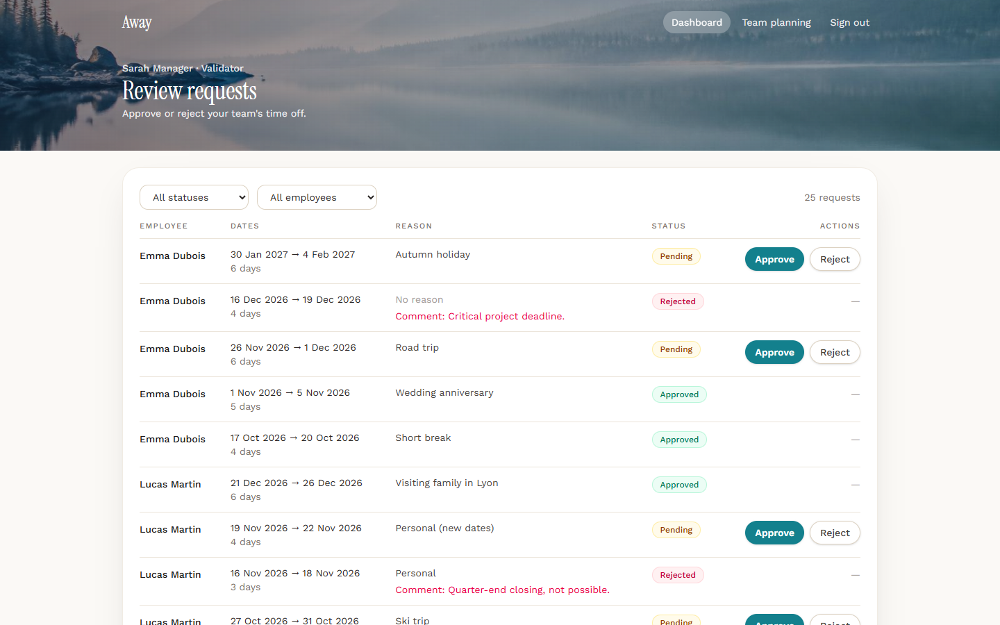
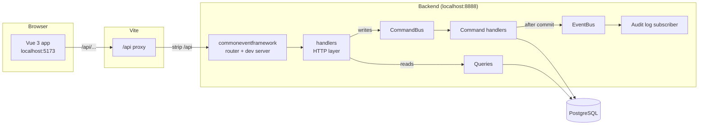
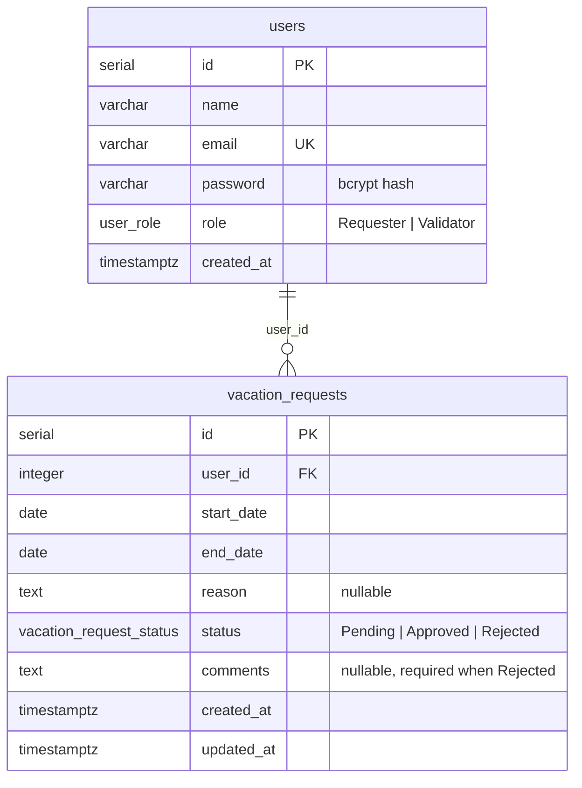
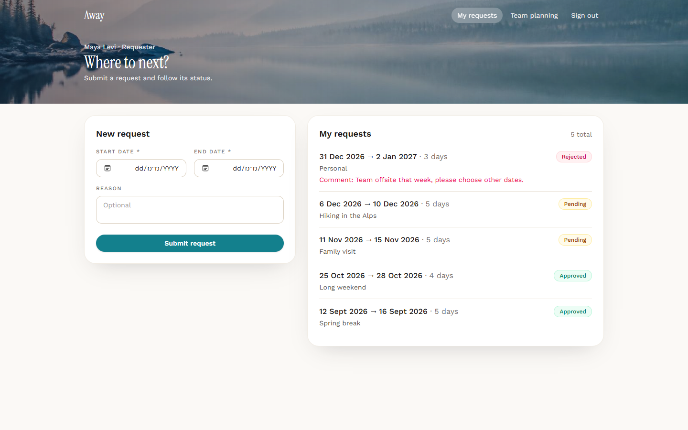
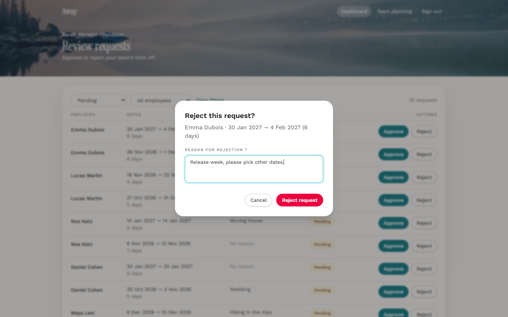
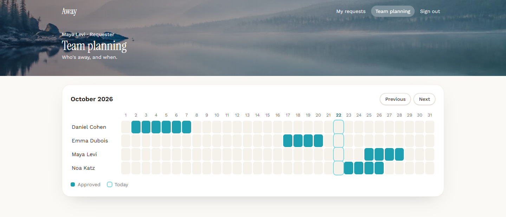
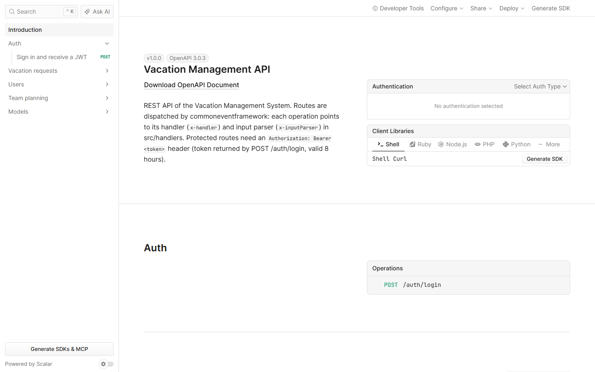
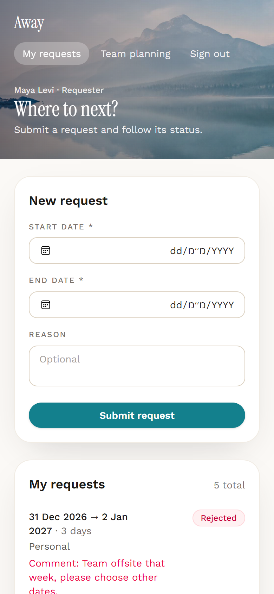

# Away — Vacation Management System

A web application to submit and review vacation requests, with two roles:

- **Requester**: submits vacation requests and follows their status.
- **Validator**: reviews every request, filters them, approves or rejects them (with a comment).

Both roles share a **team planning** calendar of approved absences.

| | |
|---|---|
| **Frontend** | Vue 3 · Vue Router · Pinia · Axios · Tailwind CSS 4 · Vite 6 · TypeScript |
| **Backend** | Node.js · TypeScript · [commoneventframework](https://www.npmjs.com/package/commoneventframework) · TypeORM · Zod · JWT |
| **Database** | PostgreSQL 16 (Docker Compose) |
| **Tests** | Vitest — 64 unit tests + 32 integration tests against a real PostgreSQL database |



---

## Table of contents

1. [Quick start](#quick-start)
2. [Demo accounts](#demo-accounts)
3. [Installation and run, step by step](#installation-and-run-step-by-step)
4. [Requirements coverage](#requirements-coverage)
5. [Architecture](#architecture)
6. [API](#api)
7. [Business rules](#business-rules)
8. [Database](#database)
9. [Frontend](#frontend)
10. [Tests](#tests)
11. [Technical decisions](#technical-decisions)
12. [Known limitations](#known-limitations)
13. [Approach](#approach)
14. [Screenshots](#screenshots)

---

## Quick start

Prerequisites: **Node.js 20+**, **npm**, **Docker Desktop** (running).

```bash
# 1. Database
docker compose up -d --wait

# 2. Backend (terminal 1)
cd backend
cp .env.example .env          # PowerShell: Copy-Item .env.example .env
npm ci
npm run db:migrate
npm run db:seed
npm run dev                   # API on http://localhost:8888 — docs on http://localhost:8888/doc

# 3. Frontend (terminal 2)
cd frontend
npm ci
npm run dev                   # App on http://localhost:5173
```

Open **http://localhost:5173** and click **Requester** or **Validator** on the login page.

## Demo accounts

All accounts use the password **`password`**.

| Role | Email | Notes |
|------|-------|-------|
| Validator | `sarah.manager@example.com` | Reviews every request |
| Requester | `maya.levi@example.com` | Has Pending, Approved and Rejected requests |
| Requester | `daniel.cohen@example.com` | |
| Requester | `noa.katz@example.com` | |
| Requester | `lucas.martin@example.com` | |
| Requester | `emma.dubois@example.com` | |

The seed creates **25 requests** in mixed statuses (10 Pending, 10 Approved, 5 Rejected), with dates
relative to today, so the dashboard pagination, the filters and the team planning always have data.
It is **idempotent**: run `npm run db:seed` again at any time to reset the demo data.

---

## Installation and run, step by step

### 1. Database

```bash
docker compose up -d --wait
```

Starts **PostgreSQL 16** in a container named `vacation-postgres` on port **5432**
(user `vacation`, password `vacation`, database `vacation_management`), with a named volume so data
survives restarts. `--wait` returns once the healthcheck reports the database ready.

> Port 5432 already used? Change the left side of `"5432:5432"` in `docker-compose.yml` and set the
> same port in `backend/.env` (`DB_PORT`).

### 2. Backend

```bash
cd backend
cp .env.example .env
npm ci
```

`.env` values (all mandatory — the server never falls back to a hidden default):

| Variable | Default in `.env.example` | Purpose |
|----------|---------------------------|---------|
| `DB_HOST` / `DB_PORT` | `localhost` / `5432` | PostgreSQL address |
| `DB_USER` / `DB_PASSWORD` / `DB_NAME` | `vacation` / `vacation` / `vacation_management` | Credentials (match `docker-compose.yml`) |
| `JWT_SECRET` | placeholder | Secret used to sign tokens. Fine for local use; use a long random value elsewhere |
| `LAMBDA_NAME` | `vacation-management-api` | Used by commoneventframework (AWS Parameter Store stays disabled) |

Create the schema, then load the demo data:

```bash
npm run db:migrate   # applies the migrations (npm run db:revert undoes the last one)
npm run db:seed      # demo users + 25 requests (idempotent)
```

Start the API:

```bash
npm run dev          # commoneventframework dev server on http://localhost:8888
```

Interactive API documentation (generated from `src/root.yaml`): **http://localhost:8888/doc**.

### 3. Frontend

```bash
cd frontend
npm ci
npm run dev          # http://localhost:5173
```

The Vite dev server proxies every `/api/*` call to `http://localhost:8888` (see
[Technical decisions](#technical-decisions)), so no CORS configuration is needed.

### 4. Tests

```bash
cd backend
npm test                  # unit + integration (needs the database container)
npm run test:unit         # unit only, no database (~1 s)
npm run test:integration  # integration only
npm run test:coverage     # unit tests + coverage report (100% enforced on the business rules)
```

Integration tests create and use a **separate database** (`vacation_management_test`) in the same
container. The demo data is never touched.

### All scripts

| Folder | Script | Description |
|--------|--------|-------------|
| backend | `npm run dev` | API dev server (ts-node + commoneventframework) on port 8888 |
| backend | `npm run build` | CEF build: regenerates the handler registry, bundles `src/index.ts` → `dist/index.js` (AWS Lambda handler) |
| backend | `npm run codegen` | Regenerates `src/generated/HandlerRegistry.ts` from `src/root.yaml` |
| backend | `npm run db:migrate` / `db:revert` / `db:seed` | Database schema and demo data |
| backend | `npm run typecheck` | TypeScript check of `src` and `tests` |
| backend | `npm test` (+ `:unit`, `:integration`, `:coverage`) | Vitest |
| frontend | `npm run dev` | Vite dev server on port 5173 |
| frontend | `npm run build` | Type check (`vue-tsc`) + production build |

---

## Requirements coverage

| Requirement | Implementation |
|-------------|----------------|
| Vue.js frontend | Vue 3 + `<script setup>` + TypeScript |
| Node.js backend | TypeScript on Node.js 20, routed by commoneventframework |
| PostgreSQL + TypeORM | PostgreSQL 16 in Docker, TypeORM entities + hand-written migration |
| Modern CSS framework | Tailwind CSS 4 |
| Common event framework | Routing, input parsing, responses, dev server and `/doc` — see [what CEF does](#commoneventframework-cef) |
| Login endpoint, JWT, protected routes, 2 roles | `POST /auth/login` → JWT (8 h); every other route checks the token and the role |
| Requester form (start, end, reason optional) | `RequestForm` component + `POST /vacation-requests` |
| Requester list with statuses | "My requests" page + `GET /vacation-requests/mine` (paginated) |
| Team vacation planning for both roles | "Team planning" page + `GET /team-planning` |
| Validator dashboard, filters by status and user, pagination | Dashboard page + `GET /vacation-requests?status&userId&page&limit` |
| Approve / reject, comment required to reject | `PUT /vacation-requests/:id/approve` and `/reject` + `ConfirmModal` |
| 6 business rules | See [Business rules](#business-rules) — enforced in the backend, mirrored in the UI |
| Commands / events | `CreateVacationRequestCommand`, `ApproveVacationRequestCommand`, `RejectVacationRequestCommand`, `LoginCommand`; `VacationRequestCreated/Approved/RejectedEvent` |
| Input validation, error handling, pagination, RBAC | Zod schemas, uniform error body, `{ data, meta }` pages, role check before validation |
| Users / VacationRequests schema | Column names exactly as specified (snake_case) |
| Vue Router, Axios | Router with auth and role guards; Axios instance with JWT and 401 interceptors |
| Reusable components | `StatusBadge`, `Pagination`, `DataTable`, `ConfirmModal`, `RequestForm` |

---

## Architecture

### Overview



### Request lifecycle (example: approving a request)

```text
PUT /vacation-requests/42/approve
 1. CEF finds the route in root.yaml
 2. x-inputParser  → verify JWT (401) → check role = Validator (403) → validate id (400)
                     returns { auth: { userId, role }, id }
 3. x-handler      → new ApproveVacationRequestCommand(42, auth.userId) → CommandBus
 4. Command handler→ UPDATE ... SET status='Approved' WHERE id=42 AND status='Pending'
                     0 rows → 404 (unknown id) or 409 (already reviewed)
 5. EventBus       → VacationRequestApprovedEvent → audit log subscriber
 6. Response       → 200 + the updated request
```

### commoneventframework (CEF)

CEF ("Common Event Framework for Lambda AWS") normalizes AWS events (API Gateway, SQS, S3…) into a
single `CommonEvent` and routes requests to handlers declared in an OpenAPI file. The "event" in its
name is the *AWS event*; it is the **HTTP / transport layer** of this project. The project follows
its README conventions exactly:

| CEF feature | Used for |
|-------------|----------|
| `npx cef-init` | Scaffolded the backend (`src/index.ts`, `src/root.yaml`, `src/handlers/types.ts`, `tsconfig.json`) |
| `root.yaml` with `x-handler` / `x-inputParser` | Every route, with request and response schemas |
| `cef-gen-handlers` (`npm run codegen`) | Generates `src/generated/HandlerRegistry.ts` (static imports for the bundle) |
| Entry point pattern (`buildCommonEvent`, `getRouteConfig`, `resolveHandlerRef`) | `src/index.ts`, unchanged from the README |
| `x-inputParser` returning a `Response` | Authentication, authorization and validation stop the request before the handler |
| `Response` class | Every HTTP answer (JSON + CORS headers) |
| `startDevServer` | Local API server (`npm run dev`) |
| `loadEnv()` / `getEnvValue()` | `.env` loading; mandatory variables (`src/config.ts`) |
| `GET /doc` | Interactive API documentation generated from `root.yaml` |
| `cef-build` (`npm run build`) | Bundles the API into a single AWS Lambda handler (`dist/index.js`) |

The **Command / Event architecture is this project's own code** (`src/shared/cqrs`), built on top of
CEF. CEF is imported only in `src/index.ts` and `src/handlers/**`, plus `src/config.ts` (env) and the
CLI scripts. The business layer (`src/modules`, `src/shared`) does not depend on it: replacing CEF
with another HTTP framework would only touch `src/handlers` and `src/index.ts`.

### Commands, events and queries

| Command | Handler checks | Event published (after commit) |
|---------|----------------|---------------------------------|
| `LoginCommand` | Email + bcrypt password | — |
| `CreateVacationRequestCommand` | Rules 1, 4 (pure), rule 2 (locked transaction) | `VacationRequestCreatedEvent` |
| `ApproveVacationRequestCommand` | Rule 3 (conditional update) | `VacationRequestApprovedEvent` |
| `RejectVacationRequestCommand` | Rule 5 (pure), rule 3 (conditional update) | `VacationRequestRejectedEvent` |

- **Commands** change state and go through the `CommandBus` (one handler per command class).
- **Events** state facts. They are published only **after** the transaction commits, so a subscriber
  never hears about a rolled-back change. A failing subscriber is logged and never breaks the request.
- The **audit log subscriber** writes one JSON line per event, including the validator's id:
  `[audit] {"event":"VacationRequestApproved","requestId":42,"userId":3,"validatorId":1,...}`.
  New reactions (e-mail, Slack) can be added as subscribers without touching any command.
- **Queries** (lists, team planning, users) only read: they are plain functions, not commands
  (light CQRS).
- Wiring happens in one place: `src/bootstrap.ts` (composition root).

### Project structure

```text
.
├── docker-compose.yml                 PostgreSQL 16
├── backend/
│   ├── src/
│   │   ├── index.ts                   CEF entry point (Lambda handler + dev server)
│   │   ├── root.yaml                  OpenAPI routes → x-handler / x-inputParser, served at /doc
│   │   ├── generated/                 HandlerRegistry.ts (generated by cef-gen-handlers)
│   │   ├── bootstrap.ts               Composition root: command → handler, event → subscribers
│   │   ├── config.ts                  The only file reading environment variables
│   │   ├── handlers/                  HTTP layer (the only code that knows CEF)
│   │   │   ├── http/                  auth-guard, error-response, parse-input
│   │   │   ├── auth.ts  vacationRequests.ts  users.ts  teamPlanning.ts
│   │   ├── modules/                   Business logic (no HTTP, no CEF)
│   │   │   ├── auth/                  LoginCommand, JWT, schemas
│   │   │   ├── users/                 User entity, requesters query
│   │   │   └── vacation-requests/
│   │   │       ├── commands/          create / approve / reject + shared conditional update
│   │   │       ├── vacation-request.rules.ts     Pure business rules
│   │   │       ├── vacation-request.events.ts    Domain events
│   │   │       ├── vacation-request.queries.ts   Read side
│   │   │       ├── vacation-request.schemas.ts   Zod validation
│   │   │       ├── vacation-request.entity.ts / .dto.ts / audit-log.subscriber.ts
│   │   ├── shared/                    cqrs (CommandBus, EventBus), errors, pagination, dates
│   │   └── database/                  data-source (lazy), migrations, migrate + seed scripts
│   └── tests/                         unit/ (no DB) and integration/ (real PostgreSQL)
└── frontend/
    ├── vite.config.ts                 /api proxy → :8888
    └── src/
        ├── api/                       Axios instance + one module per resource
        ├── stores/auth.ts             Pinia: token + user (localStorage)
        ├── router.ts                  Routes + auth / role guards
        ├── layouts/AppLayout.vue      Banner, navigation by role
        ├── components/                StatusBadge, Pagination, DataTable, ConfirmModal, RequestForm, Spinner
        ├── views/                     Login, MyRequests, ValidatorDashboard, TeamPlanning
        └── utils/                     Dates, API error messages
```

---

## API

Base URL: `http://localhost:8888` (from the frontend: `/api`). Interactive docs: **`GET /doc`**.
Protected routes require `Authorization: Bearer <token>`.

| Method | Path | Role | Success | Description |
|--------|------|------|---------|-------------|
| POST | `/auth/login` | public | 200 | `{ email, password }` → `{ token, user: { id, name, email, role } }` |
| POST | `/vacation-requests` | Requester | **201** | `{ startDate, endDate, reason? }` → the created request (Pending) |
| GET | `/vacation-requests/mine?page&limit` | Requester | 200 | The user's own requests, paginated |
| GET | `/vacation-requests?status&userId&page&limit` | Validator | 200 | All requests with `user: { id, name }`, filterable, paginated |
| PUT | `/vacation-requests/:id/approve` | Validator | 200 | Approves a Pending request |
| PUT | `/vacation-requests/:id/reject` | Validator | 200 | `{ comment }` (required) → rejects a Pending request |
| GET | `/users` | Validator | 200 | Requesters (`id`, `name`), for the dashboard filter |
| GET | `/team-planning?from&to` | both | 200 | Approved absences overlapping the range (default: current month) |

**Conventions**

- Dates are calendar dates `YYYY-MM-DD`.
- The owner of a new request always comes from the JWT; a `userId` in the body is rejected (400).
- The validator's comment is the API field **`comment`**; it is stored in the database column
  **`comments`** (the name given in the assignment).
- Pagination: `page` (default 1), `limit` (default 10, max 50) →
  `{ data, meta: { page, limit, total, totalPages } }`, ordered by `created_at DESC, id DESC`.
- Errors always look like `{ "error": { "code", "message", "details"? } }`; for validation errors,
  `details` lists `{ field, message }`.

| Status | Code | When |
|--------|------|------|
| 400 | `VALIDATION_ERROR` | Invalid input, or rule 1 / 4 / 5 broken |
| 401 | `UNAUTHORIZED` | Missing / invalid / expired token, wrong credentials |
| 403 | `FORBIDDEN` | Valid token, wrong role |
| 404 | `NOT_FOUND` | Unknown request id |
| 409 | `CONFLICT` | Overlap (rule 2), or request no longer Pending (rule 3) |
| 500 | `INTERNAL_ERROR` | Unexpected error (details logged on the server, never returned) |

Authentication and authorization are checked **before** validation: an anonymous request gets 401 and
a wrong role gets 403, even if the body is invalid.

---

## Business rules

All rules are enforced by the backend, which is the source of truth. The frontend repeats rules 1, 4
and 5 only to give instant feedback.

| # | Rule | Where it is enforced |
|---|------|----------------------|
| 1 | End date must be after start date | Pure rule `isEndDateAfterStartDate` (strictly after: a same-day request is rejected) + DB `CHECK (end_date > start_date)` |
| 2 | No overlapping requests for the same user | `CreateVacationRequestHandler`: inclusive overlap (`start <= otherEnd AND end >= otherStart`) against the user's **Pending and Approved** requests, in a transaction that locks the user's row |
| 3 | Approved requests cannot be modified | Approve / reject is a single `UPDATE ... WHERE status = 'Pending'`; there is no edit endpoint. A reviewed request answers 409 |
| 4 | No requests in the past | Pure rule `isStartDateInPast` on creation (starting today is allowed) |
| 5 | A rejection needs a comment | Zod schema + pure rule `assertValidRejectionComment` + DB `CHECK` (Rejected ⇒ non-blank `comments`) |
| 6 | Only validators approve / reject | Role check in the input parser of the approve / reject routes (403) |

Interpretations, stated explicitly:

- **Rule 1** is read literally ("after"): a request must cover at least two days. Allowing single-day
  vacations would mean changing the rule and the `chk_vacation_requests_end_after_start` constraint to `>=`.
- **Rule 2** ignores Rejected requests: rejected dates are free again.
- **Rule 4** applies when a request is **created**. A validator can still approve or reject a Pending
  request whose start date has passed, so no request gets stuck.

---

## Database



- Column names follow the assignment exactly. The schema is created by a hand-written TypeORM
  migration (`synchronize` is off).
- PostgreSQL enums for `role` and `status`; `CHECK` constraints for rules 1 and 5; foreign key with
  `ON DELETE RESTRICT`.
- `start_date` / `end_date` are `date` columns and are read back as `"YYYY-MM-DD"` strings (no time
  zone shift).

**Indexes** (each one is commented in the migration with the query it serves):

| Index | Serves |
|-------|--------|
| `(user_id, start_date, end_date)` | Overlap check on create |
| `(user_id, created_at, id)` | "My requests" and the dashboard's user filter, ordered by `created_at DESC, id DESC` |
| `(status, created_at, id)` | Dashboard status filter, same ordering |

The equality column comes first, then the sort or range columns: a composite index is only usable
from its leftmost column. With these, a dashboard page is **2 SQL statements** (one `SELECT ... JOIN
users ... LIMIT`, one `COUNT`), whatever the page size: no N+1.

**Concurrency**

- *Create*: `SELECT ... FROM users WHERE id = :userId FOR UPDATE` at the start of the transaction
  serializes the requests of one user; without it, two parallel requests could both pass the overlap
  check. (A test proves it: without the lock, 5 parallel identical requests all get created.)
- *Approve / reject*: the status check and the write are one statement, so two validators clicking at
  the same time cannot both succeed; the second one gets 409.

---

## Frontend

| Route | Role | Page |
|-------|------|------|
| `/login` | guests | Split screen: beach photo + sign-in form, one-click demo accounts |
| `/my-requests` | Requester | New request form + paginated list with status badges and rejection comments |
| `/dashboard` | Validator | Filters (status, employee), table, pagination, approve / reject dialog |
| `/team-planning` | both | Month grid of approved absences, previous / next month |

- **Guards**: signed-out users are sent to `/login?redirect=...` and come back after signing in;
  each role is redirected away from the other role's pages.
- **Auth**: the token and user are kept in the Pinia store and in `localStorage`. An Axios request
  interceptor reads the token on every request. On a 401, the response interceptor signs the user out
  and shows "Your session has expired" — except for the login request itself, so "Invalid email or
  password" stays on the form.
- **State in the URL**: dashboard filters and page (`?status=Pending&userId=3&page=2`) and the
  planning month (`?month=2026-11`) live in the URL, so refresh, back / forward and shared links keep
  the same view.
- **Every data view** has loading (skeletons), empty, error (with retry) and success states.
- **Responsive**: the dashboard table becomes cards on mobile; the planning grid scrolls horizontally
  with the names pinned and opens on today's date.
- **Edge cases**: if another validator already handled a request, the dialog closes, the 409 message
  is shown and the list refreshes; if the current page becomes empty after an action, the dashboard
  moves to the last existing page.

**Reusable components**

| Component | Purpose |
|-----------|---------|
| `StatusBadge` | Colored pill for Pending / Approved / Rejected |
| `Pagination` | "Page X of Y" with Previous / Next (stateless) |
| `DataTable` | Generic typed table (`generic="T"`), per-column slots, built-in loading / empty states, cards on mobile |
| `ConfirmModal` | Accessible dialog (focus management, Escape), optional required comment, loading and error states |
| `RequestForm` | Start / end / reason with client-side rule checks and server field errors |

**Images**: both photos are stored locally (`frontend/src/assets/images/`): `login-beach.jpg` for the
login screen, `hero-mountains.jpg` for the banner of the inner pages. No image is hot-linked.

---

## Tests

```text
tests/
├── unit/                              64 tests, no database
│   ├── vacation-request.rules.test.ts Rules 1, 2, 4, 5 (100% coverage enforced)
│   ├── cqrs.test.ts                   CommandBus and EventBus
│   ├── validation.test.ts             Pagination and Zod schemas
│   └── dates.test.ts                  Date helpers
└── integration/                       32 tests, real PostgreSQL (vacation_management_test)
    ├── create-vacation-request.test.ts Rules 1, 2, 4, events, concurrency (row lock)
    ├── review-vacation-request.test.ts Approve / reject, rules 3 and 5, 404 / 409, race between validators
    ├── login.test.ts                   Credentials, token, no account enumeration
    └── queries.test.ts                 Lists, filters, stable ordering, team planning, requesters
```

- Command handlers are tested against a **real database** rather than mocks: their correctness
  depends on transactions, row locks, conditional updates and constraints, which a mock cannot
  reproduce. The test database is created and migrated automatically, emptied before each test, and
  the reset helper refuses to run on a database whose name does not end with `_test`.
- "Today" is injected into `CreateVacationRequestHandler`, so tests use fixed dates and never depend
  on the real calendar.
- The concurrency test was checked against a deliberately broken version (lock removed): it fails, as
  it should.

---

## Technical decisions

| Decision | Why |
|----------|-----|
| **CEF as the HTTP layer, own CommandBus / EventBus** | CEF provides routing, input parsing, responses and the dev server, but no command / event bus. The architecture asked for is therefore explicit code, independent from the transport. |
| **Authentication in the input parser** | CEF calls the parser before the handler and stops on a returned `Response`. Verifying the JWT there (synchronously) guarantees 401 → 403 → 400 ordering. |
| **`PUT` instead of `PATCH` for approve / reject** | CEF only declares `OPTIONS, GET, POST, PUT, DELETE` (its `Response` CORS headers and dev-server preflight); a browser blocks a cross-origin `PATCH` (verified). |
| **Vite `/api` proxy** | The app and the API share one origin, so the browser applies no CORS rules. CEF's dev server answers preflights with `Access-Control-Allow-Headers: *`, which the Fetch standard does not let cover `Authorization` (Chromium tolerates it, stricter browsers may not). |
| **Query strings decoded by the HTTP layer** | CEF's dev server passes query values through raw (`%32` stays `%32`, verified); `getQueryParams()` decodes them. |
| **Explicit column types and explicit entity / migration lists** | `cef-build` bundles with esbuild, which does not emit decorator metadata; glob paths would not survive bundling. `emitDecoratorMetadata` is off in development too, so a missing type fails early. |
| **Dates as `YYYY-MM-DD` strings end to end** | No time-zone shifts: the `pg` type parser returns `date` columns as strings, and the frontend builds dates at local noon. |
| **Row lock for overlaps, conditional update for reviews** | Correct under concurrency without serializable transactions (see [Database](#database)). |
| **Events after commit, failures isolated** | Subscribers never see rolled-back changes and can never fail a successful request. |
| **Light CQRS: reads are plain query functions** | Reads change nothing and publish nothing; a query bus would add ceremony without value. |
| **No client-side page cache** | Requests are shared and change often (other validators, new requests); every page change refetches. A page costs 2 indexed SQL statements. A stale-while-revalidate cache (e.g. TanStack Query) would be the next step at a larger scale. |
| **`GET /users` returns requesters only, `id` + `name`** | It exists for the dashboard filter; validators own no requests; no e-mail or password ever leaves the server. |
| **Team planning: Approved only, no reason / comment** | The planning is visible to every employee: unapproved requests and private texts are not shared. |
| **Login: same message and similar timing for unknown e-mail and wrong password** | Prevents account enumeration (a bcrypt comparison runs against a dummy hash when the e-mail is unknown). |
| **JWT: HS256 only, 8 h, secret mandatory** | `algorithms: ["HS256"]` prevents algorithm-confusion attacks; no default secret in code. |
| **bcryptjs** | Pure JavaScript: no native build on Windows. |
| **Lazy, single DataSource initialization** | `.env` is loaded asynchronously by CEF; connecting on first use avoids reading configuration too early and shares one pool. |
| **Exact dependency versions, audited** | Versions are pinned and were chosen at least two weeks after release. The audit led to upgrading TypeORM to 0.3.31 (SQL-injection advisory up to 0.3.30) and moving the frontend to Tailwind CSS 4 and Vite 6.4. |

---

## Known limitations

- **No edit or cancel endpoint**: not required by the assignment. A requester cannot modify a Pending
  request; rule 3 is enforced through approve / reject, which only act on Pending requests.
- **In-memory EventBus**: events are not persisted and not retried. A real system would use an outbox
  table or a message broker (CEF already supports SQS events).
- **No refresh token**: after 8 hours the user signs in again.
- **JWT in `localStorage`**: readable by any script running on the page (XSS). An `httpOnly` cookie
  would be safer.
- **No rate limiting on `POST /auth/login`**.
- **Day counts are calendar days**: weekends and public holidays are not excluded (they differ by
  country).
- **"Today" is the server's local date** for rule 4; the UI uses the browser's date. Users far from
  the server's time zone may see a one-day difference around midnight.
- **No automated frontend tests**: the UI was verified with scripted end-to-end runs in a real browser
  during development, but they are not part of the repository.
- **Team planning has no dedicated index** (status + date range); fine for this data size.
- **Development setup only**: no production deployment configuration. `npm run build` produces an AWS
  Lambda bundle (`dist/index.js`) and a static frontend build, but hosting them is out of scope.
- **Dependency audit**: the remaining `npm audit` findings come from inside `commoneventframework`
  (adm-zip, aws-sdk v2, esbuild 0.15), which the assignment requires, plus one moderate Vitest
  advisory (UI / browser mode only, not used here) fixed in a release newer than two weeks.

---

## Approach

1. **Read the requirements and the CEF package itself** before writing code: its README and source
   show it is a routing / transport framework, which shaped the architecture (CEF for HTTP, own
   command / event layer for the business).
2. **Plan and decide first**: API, schema, indexes, concurrency strategy and folder structure were
   written down and agreed before implementation.
3. **Vertical slice first**: login → create request → my requests, end to end (backend, frontend,
   browser), before adding the validator features. Assumptions about CEF (query-string decoding,
   CORS, PATCH) were then verified in practice.
4. **One step = one commit**, each step tested (API checks, browser runs, then the Vitest suite)
   before committing.

---

## Screenshots

| Login | My requests |
|-------|-------------|
|  |  |

| Validator dashboard | Reject dialog (comment required) |
|---------------------|----------------------------------|
|  |  |

| Team planning | API documentation (`GET /doc`) |
|---------------|-------------------------------|
|  |  |

<p align="center"></p>
